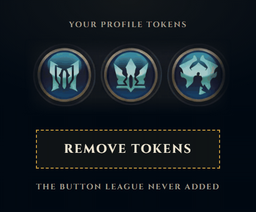
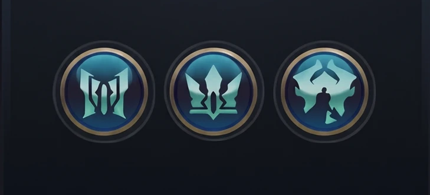
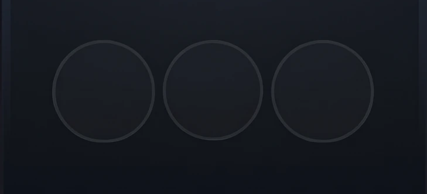
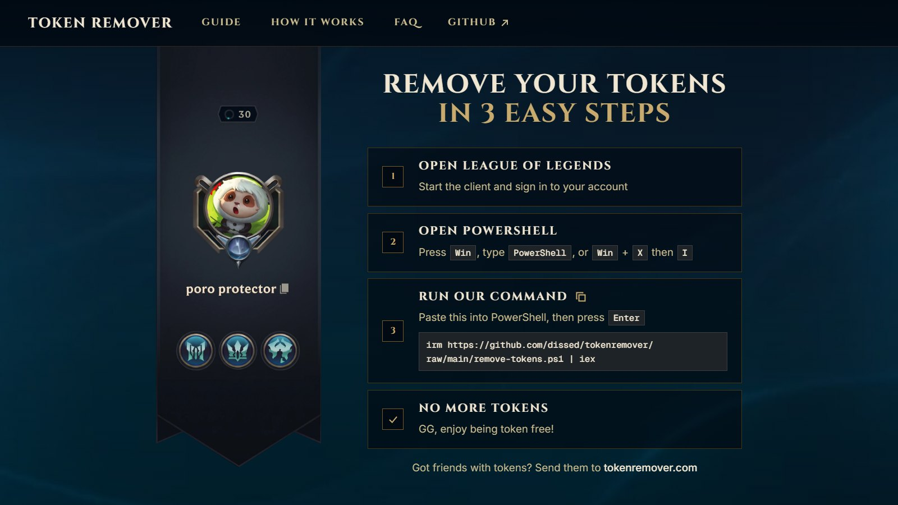

<div align="center">


# Token Remover

**Remove the challenge tokens from your League of Legends profile in 3 easy steps.**

Free, open source, nothing to install.

[**tokenremover.com**](https://tokenremover.com)




</div>

## What it does

The League client lets you swap the three tokens on your profile, but it has no
button to clear them. Token Remover is that button.

| Before | After |
| :---: | :---: |
|  |  |

## Guide

**1. Open League of Legends**

Start the client and sign in to your account.

**2. Open PowerShell**

Press <kbd>Win</kbd>, type `PowerShell` and press <kbd>Enter</kbd>. Or press
<kbd>Win</kbd> + <kbd>X</kbd>, then <kbd>I</kbd>.

**3. Run our command**

Paste this into PowerShell, then press <kbd>Enter</kbd>:

```powershell
irm https://github.com/dissed/tokenremover/raw/main/remove-tokens.ps1 | iex
```

**No more tokens.** You should see something like this:

```text
Tokens currently equipped (3):
  - <your first token>
  - <your second token>
  - <your third token>

Done. Your tokens have been removed.
```

GG, enjoy being token free!

## How it works

- **Nothing new.** The League client can already remove tokens from your
  profile. Riot just never added a button for it.
- **We do it for you.** Our script talks to the League client running on your
  own PC and asks it to do that one thing.
- **Nothing fancy happens.** No hacks and no changed game files. Your title,
  banner and crest stay the same, and you can add tokens back any time.

When you run the command:

1. PowerShell downloads [`remove-tokens.ps1`](remove-tokens.ps1) straight from this repository.
2. Our script finds the League client that is open on your PC.
3. It asks the client which tokens you have equipped.
4. It saves your profile again with an empty token list, then checks that it worked.

Our script only talks to the client on your own machine (`127.0.0.1`). It never
sees your Riot login, and nothing is sent anywhere else.

### Check it yourself

The whole script is one short file: [`remove-tokens.ps1`](remove-tokens.ps1).
Because the command points at this repository, what you read here is exactly
what runs.

To see what would be sent without changing anything, download the file and run
it with `-DryRun`:

```powershell
.\remove-tokens.ps1 -DryRun
```

## FAQ

**Will this get me banned?**
It is extremely unlikely. Our script is cosmetic only and uses a command already
built into the client. Riot does not officially support third-party tools, so
use it at your own risk.

**Is this safe for my PC?**
Yes. Our script installs nothing, needs no admin rights, and is open source so
anyone can check it.

**Why isn't it working?**
Our script needs League open and logged in. Check that, then run the command
again. Make sure you are in PowerShell or Terminal, not Command Prompt.

**Is this reversible?**
Removed tokens are not deleted, just unequipped. Add them back at any time.

**Will it work after a patch?**
It should. If a patch ever breaks our script, we fix it and the same command
keeps working.

**What are the requirements?**
Windows 10 or 11, and League of Legends open and logged in. Nothing else.

## The website

<a href="https://tokenremover.com"></a>

[tokenremover.com](https://tokenremover.com) is served straight from this
repository with GitHub Pages.

| File | What it is |
| --- | --- |
| [`remove-tokens.ps1`](remove-tokens.ps1) | The script. This is what the command runs. |
| [`site/page.html`](site/page.html) | The web page. |
| [`build.ps1`](build.ps1) | Joins the page and the script into `index.html`. |
| `index.html` | Built file. Do not edit it by hand. |

After changing the page or the script, rebuild with:

```powershell
.\build.ps1
```

## License

The code is released under the [MIT License](LICENSE). The game art in `img/`
belongs to Riot Games and is not covered by it.

---

<div align="center">

Token Remover is not affiliated with or endorsed by Riot Games.
All game art belongs to Riot Games. Use at your own risk.

</div>
