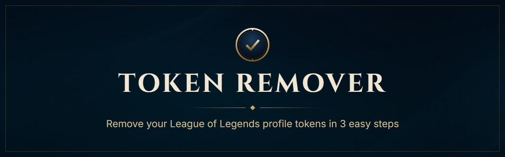

<div align="center">

<a href="https://tokenremover.com"></a>

[**tokenremover.com**](https://tokenremover.com)

</div>

The League client lets you swap the three tokens on your profile, but it has no
button to clear them. Token Remover is that button.

## Guide

**1. Open League of Legends**

Start the client and sign in to your account.

**2. Open PowerShell**

Press <kbd>Win</kbd>, type `PowerShell` and press <kbd>Enter</kbd>.

**3. Run our command**

Paste this into PowerShell, then press <kbd>Enter</kbd>:

```powershell
irm https://github.com/dissed/tokenremover/raw/main/remove-tokens.ps1 | iex
```

**No more tokens.** GG, enjoy being token free!

## How the code works

Everything that runs on your PC is one short file,
[`remove-tokens.ps1`](remove-tokens.ps1). It is commented line by line, and the
command above runs that exact file. Here is what it does, in order.

**1. It finds the League client.**
Our script looks for the running client and reads its `lockfile`, a small text
file the client writes when it starts. The file holds a port number and a
temporary password for the client's own local controls. It is not your Riot
password, and it only works on your PC.

```powershell
$parts = (Get-Content -LiteralPath $lockfile -Raw).Trim().Split(':')
$lcu = @{ Port = $parts[2]; Token = $parts[3] }
```

**2. It only talks to your own PC.**
Every request goes to `127.0.0.1`, which always means "this computer". Nothing
is sent over the internet.

```powershell
$url = "https://127.0.0.1:$($Lcu.Port)$Path"
```

**3. It asks the client what is on your profile.**
This is read only. It tells our script which tokens you have, and your current
title, banner and crest.

```powershell
$SummaryPath = '/lol-challenges/v1/summary-player-data/local-player'
```

**4. It saves your profile with no tokens.**
This is the one request that changes anything. The token list is empty, and
your title, banner and crest are sent back exactly as they were.

```powershell
$request = [ordered]@{ challengeIds = @() } + $kept
$r = Invoke-Lcu $lcu POST $UpdatePath $body
```

**5. It checks that it worked.**
Our script asks the client again and only says "Done" once the tokens are
really gone. If the client refuses, it says so and changes nothing.

### Try it without changing anything

Download [`remove-tokens.ps1`](remove-tokens.ps1) and run it with `-DryRun`. It
shows what would be sent, then stops.

```powershell
.\remove-tokens.ps1 -DryRun
```

## Good to know

- **Nothing is installed**, and no admin rights are needed.
- **No game files are touched.**
- **It is reversible.** Removed tokens are not deleted, just unequipped.
- **Requirements:** Windows 10 or 11, with League of Legends open and logged in.

## License

The code is released under the [MIT License](LICENSE). Game art belongs to Riot Games.

Token Remover is not affiliated with or endorsed by Riot Games. Use at your own risk.
